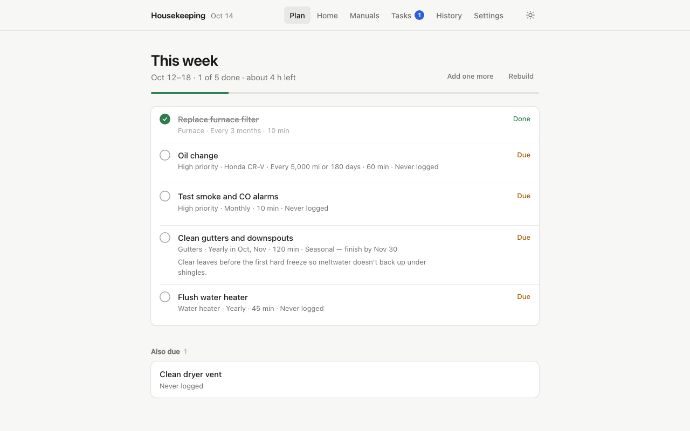
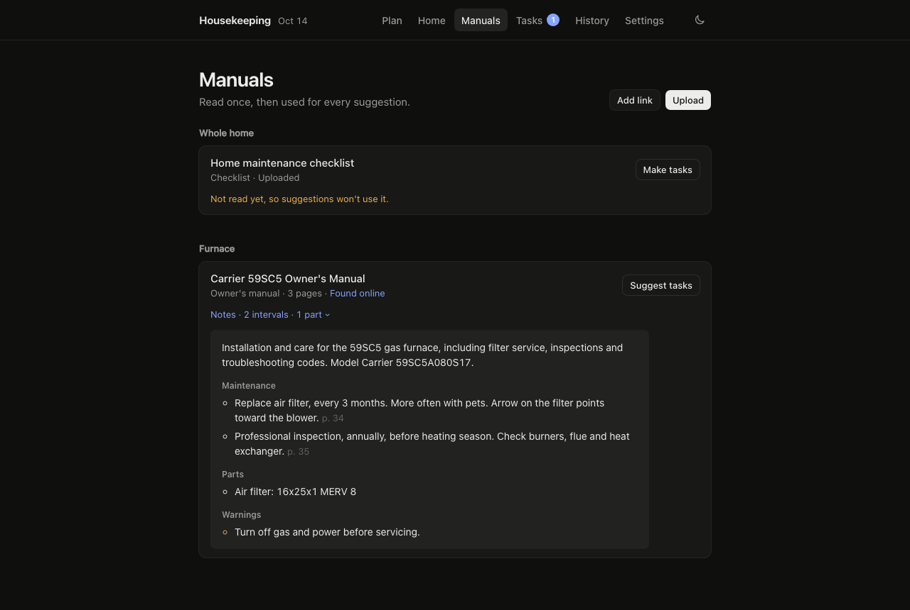
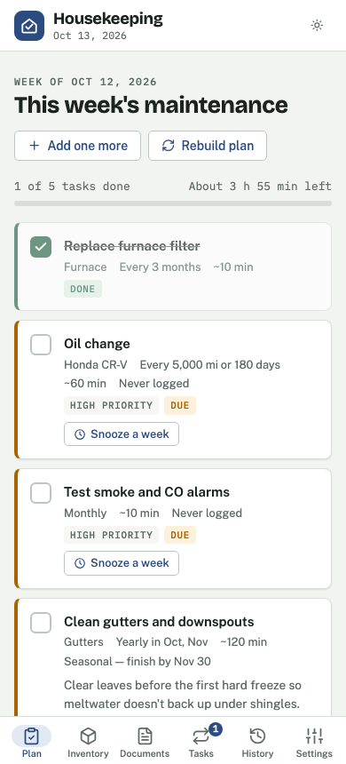

<div align="center">

```text
██╗  ██╗ ██████╗ ██╗   ██╗███████╗███████╗██╗  ██╗███████╗███████╗██████╗ ██╗███╗   ██╗ ██████╗
██║  ██║██╔═══██╗██║   ██║██╔════╝██╔════╝██║ ██╔╝██╔════╝██╔════╝██╔══██╗██║████╗  ██║██╔════╝
███████║██║   ██║██║   ██║███████╗█████╗  █████╔╝ █████╗  █████╗  ██████╔╝██║██╔██╗ ██║██║  ███╗
██╔══██║██║   ██║██║   ██║╚════██║██╔══╝  ██╔═██╗ ██╔══╝  ██╔══╝  ██╔═══╝ ██║██║╚██╗██║██║   ██║
██║  ██║╚██████╔╝╚██████╔╝███████║███████╗██║  ██╗███████╗███████╗██║     ██║██║ ╚████║╚██████╔╝
╚═╝  ╚═╝ ╚═════╝  ╚═════╝ ╚══════╝╚══════╝╚═╝  ╚═╝╚══════╝╚══════╝╚═╝     ╚═╝╚═╝  ╚═══╝ ╚═════╝
```

# Housekeeping

**A self-hosted home maintenance planner.** List your appliances, yard and cars, and get a short, fixed list of what to do each week, based on their manuals, your climate and what you've already done.

[](LICENSE)
[](#quick-start-docker)
[](https://github.com/ChrisThoma/housekeeping/actions/workflows/ci.yml)



</div>

## Features

- **Inventory of everything that needs care.** Appliances, home systems, outdoor features, plants and lawn, and vehicles with model year and odometer reading.
- **Add items by photo.** Under **Add item → Scan a label**, take a picture of the rating plate, VIN sticker or plant tag. Claude fills in the kind, make and model, and year, plus specs that matter for care, such as filter size or refrigerant. It only fills in a year that's printed or decoded from a date code or VIN, and says which. The photo is kept with the item.
- **A plan with a fixed size.** Choose how many tasks you want per week (or per day). The scheduler picks the most urgent ones and keeps the list stable for the period. Snooze or pause a task to free its slot.
- **Recurring jobs and one-off tasks.** Every N days (furnace filter, 90 days), seasonal windows (clean gutters, Oct–Nov), every N miles with a time cap (oil change, 5,000 mi or 6 months), or just once, optionally by a deadline (fix the fence gate by Friday).
- **Suggestions from Claude, approved by you.** Claude proposes a schedule for each item based on its make, model, year and your climate. Nothing reaches your plan until you approve it.
- **Reads the manuals.** *Find manuals* searches the web for an item's owner's manual and downloads it. Spec sheets and parts pages are discarded. You can also upload PDFs or photos of a data plate, or paste a link. Claude notes the maintenance intervals with page numbers, part numbers and filter sizes, and suggestions follow the manufacturer's intervals.
- **Imports your own checklist.** Under **Tasks → Import a checklist**, paste it, or upload a PDF or photo, and each recurring item becomes a task.
- **A logbook.** Every completion is recorded with the date, odometer reading and notes.
- **Self-hosted and private.** One container and a SQLite file. No account and no telemetry. It uses your system font and makes no third-party requests except to the Anthropic API.
- **Works on a phone.** Responsive layout with a bottom tab bar, light and dark themes, and it can be installed to your home screen.

<table>
<tr>
<td width="68%"></td>
<td width="32%"></td>
</tr>
</table>

## Quick start (Docker)

You need Docker with Compose v2.24 or later, and an [Anthropic API key](https://console.anthropic.com/settings/keys) for the Claude features. Images are published for amd64 and arm64, so it also runs on a Raspberry Pi 4 or later and on Apple silicon.

```sh
mkdir housekeeping && cd housekeeping
curl -fsSLO https://raw.githubusercontent.com/ChrisThoma/housekeeping/main/docker-compose.yml
curl -fsSL https://raw.githubusercontent.com/ChrisThoma/housekeeping/main/.env.example -o .env
# open .env and add your ANTHROPIC_API_KEY
docker compose up -d
```

Open <http://localhost:8000>. The first screen walks you through setup.

By default only this computer can reach it. To use it from your phone or other devices, see [Running it on a server](#running-it-on-a-server).

Your data lives in the `housekeeping_housekeeping-data` Docker volume: the SQLite database plus every downloaded or uploaded document. To update to the latest release:

```sh
docker compose pull && docker compose up -d
```

To stay on one version, set `HOUSEKEEPING_VERSION=0.2.0` in `.env`. Without Compose:

```sh
docker run -d --name housekeeping -p 127.0.0.1:8000:8000 --env-file .env \
  -v housekeeping_housekeeping-data:/data --restart unless-stopped ghcr.io/christhoma/housekeeping:latest
```

This uses the same volume name as Compose, so the backup commands below work for both.

To build from source instead, clone the repository and run `docker compose up -d --build`. In a clone, `docker-compose.override.yml` swaps the published image for a local build.

### Back up and restore

Stop the app first, so the database isn't copied or replaced while it's being written. With `docker run`, use `docker stop housekeeping` and `docker start housekeeping` instead.

```sh
# Back up to ./housekeeping-backup.tar.gz
docker compose stop
docker run --rm -v housekeeping_housekeeping-data:/data -v "$PWD":/backup alpine \
  tar czf /backup/housekeeping-backup.tar.gz -C /data .
docker compose start

# Restore
docker compose stop
docker run --rm -v housekeeping_housekeeping-data:/data -v "$PWD":/backup alpine \
  tar xzf /backup/housekeeping-backup.tar.gz -C /data
docker compose start
```

The volume name is the same wherever you put the folder. Check it with `docker volume ls` before restoring: Docker creates a missing volume silently, empty.

### Running it on a server

- **To reach it from other devices**, set `HOST=0.0.0.0` in `.env`. Then **also set `HOUSEKEEPING_PASSWORD`**. Without it, anyone who can reach the port can see your data and spend your API credit, and the app logs a warning at startup.
- **Names you reach it by:** without a password, the app only answers to IP addresses, `localhost` and local names such as `nas.local` or `nas`. This stops websites you visit from reaching it through your browser (DNS rebinding). To use another name, such as `house.example.com`, add it to `HOUSEKEEPING_ALLOWED_HOSTS`. With a password set, any name works.
- With a password set, the app shows a sign-in page that browsers and password managers can save. **Keep me signed in** keeps a browser signed in for 90 days, extended as you use it, up to a year. Without it, you're signed out when the browser closes or after 12 hours of not using the app.
- **Sign out** (under Settings) signs out only that browser. **Sign out everywhere** signs out every phone and computer, for example after losing one. Changing the password does the same.
- Sessions are signed with a random key stored as `session.key` next to the database, so they survive restarts and updates. It's kept out of git and the Docker image; don't share it.
- Wrong passwords are limited: 5 from one network address within 10 minutes, or 50 from everyone together, and then sign-in is refused for a while, even with the right password. A browser that has signed in before has its own allowance instead, so strangers guessing can't lock you out of your own devices. People already signed in aren't affected.
- Scripts and uptime monitors can use HTTP basic auth (`curl -u admin:password`). Tools that wait to be asked for a password, like `wget`, also work.
- The app refuses changes sent from other websites' pages.
- The app is a single process with a SQLite database, so run one container. It isn't designed to scale horizontally.
- Behind a reverse proxy (Caddy, nginx, Traefik), point it at port 8000 at the root of a host name, like `house.example.com`; it can't run under a path like `example.com/housekeeping/`. The container trusts `X-Forwarded-*` headers from any address. To narrow that, set `FORWARDED_ALLOW_IPS` to your proxy's address. Uploads can be up to 60 MB, so raise the proxy's body size limit (for nginx, `client_max_body_size 64m`).
- Over HTTPS, the sign-in cookie is only ever sent over HTTPS, as long as the app can tell the page came over HTTPS. Caddy and Traefik tell it; with nginx, add `proxy_set_header X-Forwarded-Proto $scheme;`, or set `HOUSEKEEPING_SECURE_COOKIES=true`.
- To keep the data in a host folder instead of a volume (`-v /srv/housekeeping:/data`), make the folder writable by the container's user: `sudo chown -R 1000:1000 /srv/housekeeping`.
- `GET /api/health` returns `{"ok": true}` without a password. The container's health check uses it, and you can point uptime monitors at it too.

## Configuration

All settings are environment variables. With Docker, put them in `.env`.

| Variable | Default | What it does |
|---|---|---|
| `ANTHROPIC_API_KEY` | (none) | Turns on task suggestions, label scanning, Find manuals and document reading. Everything else works without it. |
| `HOUSEKEEPING_PASSWORD` | (none) | Turns on sign-in for the whole app, except the health check. |
| `HOUSEKEEPING_USERNAME` | `admin` | User name for sign-in. |
| `HOUSEKEEPING_MODEL` | `claude-opus-5-5` | Claude model to use. |
| `HOUSEKEEPING_DB` | `/data/housekeeping.db` in Docker, `./housekeeping.db` otherwise | Database path. Documents are stored in a `documents/` folder next to it. |
| `HOST` | `127.0.0.1` | Address the port is published on. `0.0.0.0` opens it to your network. |
| `PORT` | `8000` | Port on the host. |
| `HOUSEKEEPING_ALLOWED_HOSTS` | (none) | Extra host names the app answers to, comma-separated. A leading dot matches subdomains (`.example.com`), and `*` allows any. |
| `FORWARDED_ALLOW_IPS` | `*` in Docker | Addresses whose `X-Forwarded-*` headers are trusted. |
| `HOUSEKEEPING_TIMEZONE` | the server's | Fallback time zone for "today", e.g. `America/New_York`, until one is set under **Settings**. The app sets it from your browser the first time you open it. |
| `HOUSEKEEPING_SECURE_COOKIES` | `false` | Always mark the sign-in cookie HTTPS-only. Set it when you only reach the app over HTTPS. |
| `HOUSEKEEPING_VERSION` | `latest` | Image tag Compose runs, e.g. `0.2.0` or `0.2`. |

Location, climate notes, hemisphere, time zone and plan size are set in the app, under **Settings**. The time zone decides when "today" rolls over. Without it, a server in Docker uses UTC.

**About Claude and your documents:**
- Find manuals uses Claude's web search and web fetch tools. These must be enabled for your organization in the Anthropic Console.
- Documents Claude reads are uploaded to your Anthropic account's file storage, so re-reading a document doesn't upload it again. Deleting a document in the app deletes that copy too, even if reading it failed.
- PDFs up to 100 pages are sent whole, so Claude sees tables and diagrams. Longer PDFs are sent as extracted text. Each document is read once and the notes are reused.
- Downloads only go to public websites, never addresses on your local network. Files can be up to 60 MB and must be PDFs, web pages, images or text.

## How scheduling works

| Type | Example | When it's due |
|---|---|---|
| Every N days | Furnace filter, 90 days | N days after you last did it |
| Seasonal | Clean gutters, Oct–Nov | Once per season window. Urgency rises as the window closes. |
| Every N miles | Oil change, 5,000 mi or 180 days | Whichever comes first. Logging the odometer updates the car. If you mark it done without a reading, the miles count from the car's last known odometer. |
| One time | Fix the fence gate, by Oct 18 | A week before its deadline, or right away if it has none. Once it's done, it moves to **Done** under Tasks. A one-off you add that's already due goes straight into the current plan. |

Each active task gets an urgency score: the share of its interval that has passed. Tasks scoring 0.85 or higher are due. High-priority tasks rank ahead of others with the same urgency, and tasks you've never logged count as due now. When a week or day starts, the plan is filled with the top tasks up to your plan size, and it stays fixed until the period ends or you rebuild it.

To preview the plan for another date, add `?as_of=2026-11-20` to the URL. Previews are read-only: nothing is saved, and the app won't let you change anything until you remove it.

## Development

Requires Python 3.10 or later. No JavaScript build step: the frontend is plain HTML, CSS and JS in `static/`.

```sh
python3 -m venv .venv
.venv/bin/pip install -r requirements-dev.txt
./run.sh                          # http://localhost:8000, reloads .env
.venv/bin/python -m pytest -q     # tests, no API key or network needed
```

```
app/
  main.py        FastAPI routes, optional sign-in
  scheduler.py   urgency scores and weekly/daily plans
  ai.py          Claude calls: suggestions, guide import, reading and finding documents
  documents.py   safe downloads, PDF/HTML text extraction, file storage
  db.py          SQLite schema and settings
static/          the web app (index.html, app.js, style.css)
tests/
```

The API is documented at `/docs` (OpenAPI) in a running instance.

Contributions are welcome. See [CONTRIBUTING.md](CONTRIBUTING.md).

## License

[MIT](LICENSE).
